# Linkgraph des Wikis

Automatisch erzeugt mit `python tools/wiki_graph.py` – nicht von Hand bearbeiten.
Ein Knoten pro Wiki-Seite, ein Pfeil pro Link. `index.md` und `log.md` sind ausgeblendet.
**Rot** markiert sind Seiten, auf die keine andere Seite verlinkt.

```mermaid
graph LR
    n_datenschutz_folgenabschaetzung["Datenschutz-Folgenabschätzung"]
    n_datenschutzbeauftragte["Datenschutzbeauftragte"]
    n_dokument_fx200_wartungshandbuch["Dokument: Wartungshandbuch FX-200 (Auszug)"]
    n_dokument_ki_nutzungsrichtlinie["Dokument: Richtlinie zur Nutzung von KI-Werkzeugen"]
    n_dokument_mail_lieferant_spindellager["Dokument: E-Mail Lieferverzögerung Spindellager (14.10.2026)"]
    n_dokument_onboarding_service_2024["Dokument: Einarbeitung im Kundenservice (2024)"]
    n_dokument_protokoll_lenkungskreis_2026_10_22["Dokument: Protokoll Lenkungskreis KI (22.10.2026)"]
    n_dokument_readme_rohdokumente["Dokument: README der Rohdokumente"]
    n_dokument_rollen_im_ki_pilot["Dokument: Rollen und Verantwortlichkeiten im KI-Pilot"]
    n_einarbeitung_kundenservice["Einarbeitung im Kundenservice"]
    n_ersatzteile_und_lieferzeiten["Ersatzteile und Lieferzeiten"]
    n_fehlermeldungen_fx_200["Fehlermeldungen der FX-200"]
    n_frage_lieferzeit_spindellager_sl_40["Frage: Wie lange dauert es derzeit, ein Spindellager SL-40 zu bekommen?"]
    n_freigabe_von_ki_ergebnissen["Freigabe von KI-Ergebnissen"]
    n_freigegebene_ki_werkzeuge["Freigegebene KI-Werkzeuge"]
    n_fx_200_wartung["Wartung der FX-200"]
    n_fx_200["FX-200"]
    n_geschaeftsfuehrung["Geschäftsführung"]
    n_it_leitung["IT-Leitung"]
    n_kulanz_und_erstattungen["Kulanz und Erstattungen"]
    n_leitung_service["Leitung Service"]
    n_lenkungskreis_ki["Lenkungskreis KI"]
    n_meldeweg_bei_ki_auffaelligkeiten["Meldeweg bei KI-Auffälligkeiten"]
    n_mm_chat["MM-Chat"]
    n_pilot_serviceassistent["Pilot Serviceassistent"]
    n_spindellager_sl_40["Spindellager SL-40"]
    n_test["Testseite für die Pipeline"]
    n_datenschutz_folgenabschaetzung --> n_datenschutzbeauftragte
    n_datenschutz_folgenabschaetzung --> n_lenkungskreis_ki
    n_datenschutz_folgenabschaetzung --> n_pilot_serviceassistent
    n_datenschutzbeauftragte --> n_datenschutz_folgenabschaetzung
    n_datenschutzbeauftragte --> n_lenkungskreis_ki
    n_datenschutzbeauftragte --> n_pilot_serviceassistent
    n_dokument_fx200_wartungshandbuch --> n_fehlermeldungen_fx_200
    n_dokument_fx200_wartungshandbuch --> n_fx_200_wartung
    n_dokument_fx200_wartungshandbuch --> n_fx_200
    n_dokument_ki_nutzungsrichtlinie --> n_dokument_protokoll_lenkungskreis_2026_10_22
    n_dokument_ki_nutzungsrichtlinie --> n_freigabe_von_ki_ergebnissen
    n_dokument_ki_nutzungsrichtlinie --> n_freigegebene_ki_werkzeuge
    n_dokument_ki_nutzungsrichtlinie --> n_geschaeftsfuehrung
    n_dokument_ki_nutzungsrichtlinie --> n_it_leitung
    n_dokument_ki_nutzungsrichtlinie --> n_kulanz_und_erstattungen
    n_dokument_ki_nutzungsrichtlinie --> n_lenkungskreis_ki
    n_dokument_ki_nutzungsrichtlinie --> n_meldeweg_bei_ki_auffaelligkeiten
    n_dokument_ki_nutzungsrichtlinie --> n_mm_chat
    n_dokument_ki_nutzungsrichtlinie --> n_pilot_serviceassistent
    n_dokument_mail_lieferant_spindellager --> n_ersatzteile_und_lieferzeiten
    n_dokument_mail_lieferant_spindellager --> n_fx_200
    n_dokument_mail_lieferant_spindellager --> n_spindellager_sl_40
    n_dokument_onboarding_service_2024 --> n_einarbeitung_kundenservice
    n_dokument_onboarding_service_2024 --> n_ersatzteile_und_lieferzeiten
    n_dokument_onboarding_service_2024 --> n_fx_200_wartung
    n_dokument_onboarding_service_2024 --> n_fx_200
    n_dokument_onboarding_service_2024 --> n_leitung_service
    n_dokument_protokoll_lenkungskreis_2026_10_22 --> n_datenschutz_folgenabschaetzung
    n_dokument_protokoll_lenkungskreis_2026_10_22 --> n_geschaeftsfuehrung
    n_dokument_protokoll_lenkungskreis_2026_10_22 --> n_kulanz_und_erstattungen
    n_dokument_protokoll_lenkungskreis_2026_10_22 --> n_lenkungskreis_ki
    n_dokument_protokoll_lenkungskreis_2026_10_22 --> n_mm_chat
    n_dokument_protokoll_lenkungskreis_2026_10_22 --> n_pilot_serviceassistent
    n_dokument_rollen_im_ki_pilot --> n_datenschutz_folgenabschaetzung
    n_dokument_rollen_im_ki_pilot --> n_datenschutzbeauftragte
    n_dokument_rollen_im_ki_pilot --> n_geschaeftsfuehrung
    n_dokument_rollen_im_ki_pilot --> n_it_leitung
    n_dokument_rollen_im_ki_pilot --> n_leitung_service
    n_dokument_rollen_im_ki_pilot --> n_meldeweg_bei_ki_auffaelligkeiten
    n_dokument_rollen_im_ki_pilot --> n_pilot_serviceassistent
    n_einarbeitung_kundenservice --> n_dokument_onboarding_service_2024
    n_einarbeitung_kundenservice --> n_ersatzteile_und_lieferzeiten
    n_einarbeitung_kundenservice --> n_fehlermeldungen_fx_200
    n_einarbeitung_kundenservice --> n_fx_200_wartung
    n_einarbeitung_kundenservice --> n_fx_200
    n_einarbeitung_kundenservice --> n_leitung_service
    n_einarbeitung_kundenservice --> n_pilot_serviceassistent
    n_ersatzteile_und_lieferzeiten --> n_dokument_mail_lieferant_spindellager
    n_ersatzteile_und_lieferzeiten --> n_fx_200
    n_ersatzteile_und_lieferzeiten --> n_leitung_service
    n_ersatzteile_und_lieferzeiten --> n_spindellager_sl_40
    n_fehlermeldungen_fx_200 --> n_einarbeitung_kundenservice
    n_fehlermeldungen_fx_200 --> n_fx_200_wartung
    n_fehlermeldungen_fx_200 --> n_fx_200
    n_fehlermeldungen_fx_200 --> n_leitung_service
    n_frage_lieferzeit_spindellager_sl_40 --> n_dokument_mail_lieferant_spindellager
    n_frage_lieferzeit_spindellager_sl_40 --> n_ersatzteile_und_lieferzeiten
    n_frage_lieferzeit_spindellager_sl_40 --> n_fx_200
    n_frage_lieferzeit_spindellager_sl_40 --> n_spindellager_sl_40
    n_freigabe_von_ki_ergebnissen --> n_freigegebene_ki_werkzeuge
    n_freigabe_von_ki_ergebnissen --> n_geschaeftsfuehrung
    n_freigabe_von_ki_ergebnissen --> n_it_leitung
    n_freigabe_von_ki_ergebnissen --> n_kulanz_und_erstattungen
    n_freigabe_von_ki_ergebnissen --> n_lenkungskreis_ki
    n_freigabe_von_ki_ergebnissen --> n_meldeweg_bei_ki_auffaelligkeiten
    n_freigabe_von_ki_ergebnissen --> n_pilot_serviceassistent
    n_freigegebene_ki_werkzeuge --> n_dokument_ki_nutzungsrichtlinie
    n_freigegebene_ki_werkzeuge --> n_freigabe_von_ki_ergebnissen
    n_freigegebene_ki_werkzeuge --> n_it_leitung
    n_freigegebene_ki_werkzeuge --> n_lenkungskreis_ki
    n_freigegebene_ki_werkzeuge --> n_mm_chat
    n_freigegebene_ki_werkzeuge --> n_pilot_serviceassistent
    n_fx_200_wartung --> n_dokument_fx200_wartungshandbuch
    n_fx_200_wartung --> n_ersatzteile_und_lieferzeiten
    n_fx_200_wartung --> n_fehlermeldungen_fx_200
    n_fx_200_wartung --> n_fx_200
    n_fx_200_wartung --> n_leitung_service
    n_fx_200_wartung --> n_spindellager_sl_40
    n_fx_200 --> n_dokument_fx200_wartungshandbuch
    n_fx_200 --> n_ersatzteile_und_lieferzeiten
    n_fx_200 --> n_fehlermeldungen_fx_200
    n_fx_200 --> n_fx_200_wartung
    n_fx_200 --> n_leitung_service
    n_fx_200 --> n_spindellager_sl_40
    n_geschaeftsfuehrung --> n_dokument_ki_nutzungsrichtlinie
    n_geschaeftsfuehrung --> n_lenkungskreis_ki
    n_geschaeftsfuehrung --> n_pilot_serviceassistent
    n_it_leitung --> n_dokument_ki_nutzungsrichtlinie
    n_it_leitung --> n_kulanz_und_erstattungen
    n_it_leitung --> n_lenkungskreis_ki
    n_it_leitung --> n_pilot_serviceassistent
    n_kulanz_und_erstattungen --> n_freigabe_von_ki_ergebnissen
    n_kulanz_und_erstattungen --> n_it_leitung
    n_kulanz_und_erstattungen --> n_lenkungskreis_ki
    n_leitung_service --> n_einarbeitung_kundenservice
    n_leitung_service --> n_lenkungskreis_ki
    n_leitung_service --> n_pilot_serviceassistent
    n_lenkungskreis_ki --> n_datenschutzbeauftragte
    n_lenkungskreis_ki --> n_dokument_protokoll_lenkungskreis_2026_10_22
    n_lenkungskreis_ki --> n_geschaeftsfuehrung
    n_lenkungskreis_ki --> n_it_leitung
    n_lenkungskreis_ki --> n_leitung_service
    n_meldeweg_bei_ki_auffaelligkeiten --> n_freigabe_von_ki_ergebnissen
    n_meldeweg_bei_ki_auffaelligkeiten --> n_it_leitung
    n_meldeweg_bei_ki_auffaelligkeiten --> n_pilot_serviceassistent
    n_mm_chat --> n_freigegebene_ki_werkzeuge
    n_mm_chat --> n_it_leitung
    n_pilot_serviceassistent --> n_datenschutz_folgenabschaetzung
    n_pilot_serviceassistent --> n_datenschutzbeauftragte
    n_pilot_serviceassistent --> n_dokument_rollen_im_ki_pilot
    n_pilot_serviceassistent --> n_freigabe_von_ki_ergebnissen
    n_pilot_serviceassistent --> n_geschaeftsfuehrung
    n_pilot_serviceassistent --> n_it_leitung
    n_pilot_serviceassistent --> n_leitung_service
    n_pilot_serviceassistent --> n_lenkungskreis_ki
    n_pilot_serviceassistent --> n_meldeweg_bei_ki_auffaelligkeiten
    n_spindellager_sl_40 --> n_ersatzteile_und_lieferzeiten
    n_spindellager_sl_40 --> n_frage_lieferzeit_spindellager_sl_40
    n_spindellager_sl_40 --> n_fx_200
    classDef verwaist fill:#f88,stroke:#c00,color:#000
    class n_dokument_readme_rohdokumente,n_test verwaist
```

## Seiten ohne eingehende Links

- Dokument: README der Rohdokumente (`wiki/dokument-readme-rohdokumente.md`)
- Testseite für die Pipeline (`wiki/test.md`)
